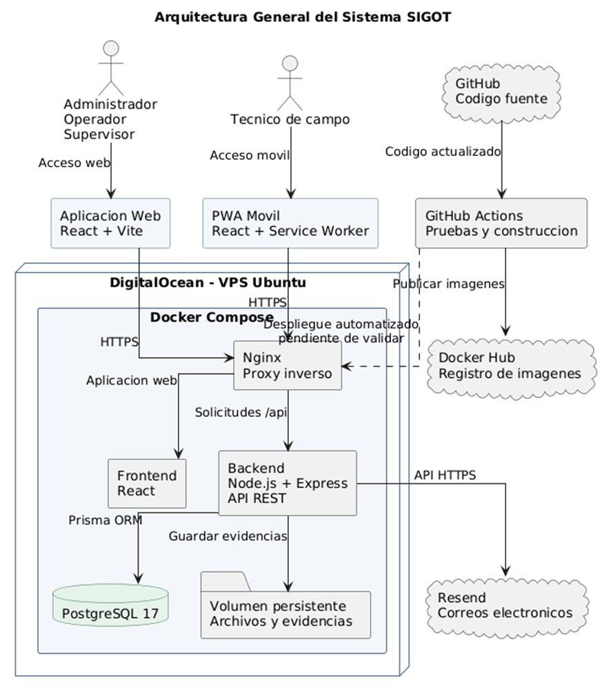
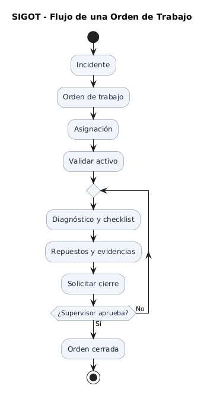
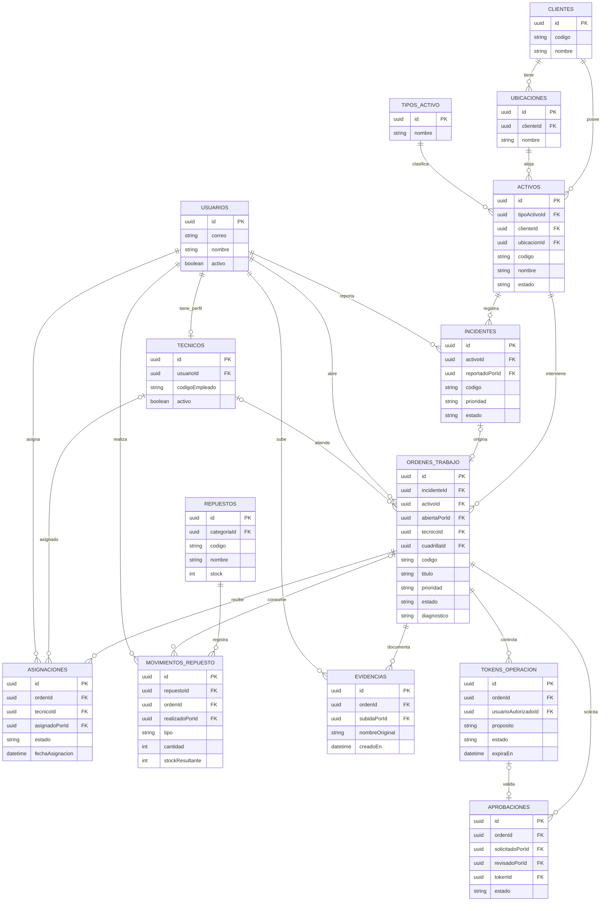
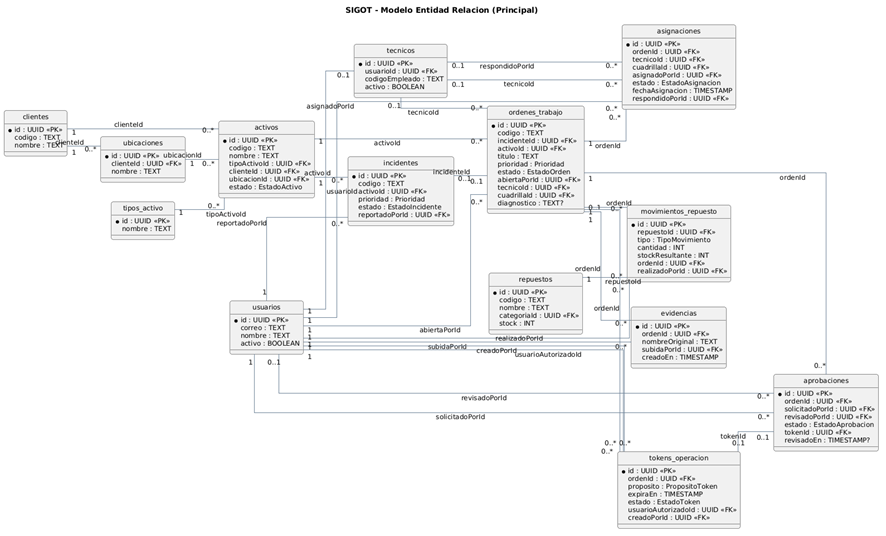
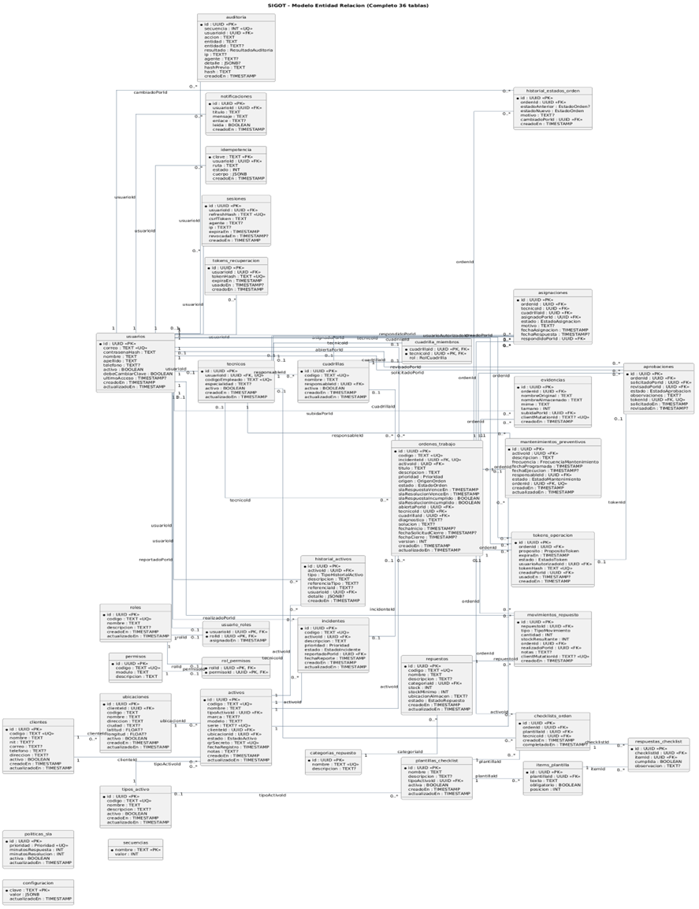

# SIGOT — Sistema Integral de Gestión de Operaciones Técnicas

**Proyecto C: Centro de Operaciones de Campo, Activos e Incidentes**  
**Universidad Mariano Gálvez de Guatemala · Curso: Desarrollo Web · Proyecto final**

SIGOT es una solución web para administrar activos de infraestructura, registrar incidentes, coordinar órdenes de trabajo, controlar repuestos y documentar intervenciones técnicas. Incluye un **panel web para personal de operaciones** y una **aplicación web progresiva (PWA) instalable para técnicos**, conectados a una misma API y base de datos PostgreSQL.

**Aplicación en producción:** https://sigot.emersontzib.site  
**Repositorio:** https://github.com/Emerson4892/SIGOT

## 1. Objetivo

Digitalizar el ciclo de atención de incidentes de campo, desde el reporte de una falla hasta la aprobación de su cierre técnico, manteniendo trazabilidad, evidencias, control de inventario, niveles de servicio (SLA), autorizaciones y registros de auditoría.

## 2. Tecnologías utilizadas

| Capa | Tecnologías |
| --- | --- |
| Aplicación web y PWA | React 19, Vite 7, React Router, Bootstrap 5, Bootstrap Icons |
| Experiencia móvil | Manifest, Service Worker, Vite PWA, IndexedDB |
| API | Node.js 22+, Express 4, API REST |
| Acceso a datos | Prisma ORM 6 y PostgreSQL 17 |
| Seguridad | Argon2id, JWT, cookies HttpOnly, CSRF, permisos por rol, validaciones Zod |
| Archivos | Almacenamiento persistente de evidencias mediante volumen Docker |
| Gráficas y QR | Chart.js, `qrcode`, `html5-qrcode` |
| Notificaciones de recuperación | Resend (correo mediante API HTTPS) |
| Contenedores | Docker, Docker Compose, imágenes versionadas en Docker Hub |
| Producción | DigitalOcean (Ubuntu), Nginx, Let's Encrypt, Certbot, HTTPS |
| Automatización y pruebas | GitHub Actions, Node Test Runner, Playwright |

## 3. Arquitectura

Se utiliza una **arquitectura cliente-servidor con API REST y backend modular**. El frontend y la PWA consumen los mismos endpoints y no acceden directamente a PostgreSQL.



**Separación de responsabilidades:**

- **Frontend:** interfaz, navegación, formularios, paneles, instalación PWA y gestión de cola local.
- **Backend:** rutas, controladores, servicios de negocio, validaciones, autorizaciones y auditoría.
- **Base de datos:** persistencia relacional e integridad mediante migraciones y restricciones.
- **Infraestructura:** contenedores, proxy inverso, certificados TLS, volúmenes y automatización.

## 4. Módulos funcionales

| Área | Funcionalidades |
| --- | --- |
| Acceso y administración | Inicio de sesión, usuarios, roles, permisos, sesiones y recuperación de contraseña |
| Clientes e infraestructura | Clientes, ubicaciones, tipos de activo, activos, identificadores y QR |
| Operaciones | Incidentes, órdenes, prioridades, asignación a técnicos o cuadrillas, cambios de estado |
| Trabajo técnico | Aceptación/rechazo, validación del activo, diagnóstico, solución y checklists |
| Inventario | Repuestos, categorías, existencias, movimientos, consumos y alertas |
| Evidencias | Fotografías y archivos relacionados con órdenes |
| Supervisión | Solicitudes de cierre, aprobación/rechazo, controles y tokens temporales para cierres críticos |
| Seguimiento | SLA, mantenimientos preventivos, historial técnico de activos |
| Gestión | Dashboard, reportes, exportación CSV, notificaciones y auditoría |

## 5. Flujo principal de una orden

1. El operador registra un **incidente** vinculado a un activo.
2. Se genera una **orden de trabajo** con prioridad y SLA.
3. Un usuario autorizado asigna la orden a un técnico o cuadrilla.
4. El técnico acepta la asignación y **valida el activo por QR o código**.
5. Registra inicio, diagnóstico, checklist y solución propuesta.
6. Si corresponde, consume repuestos; el sistema registra el movimiento y actualiza las existencias.
7. Adjunta evidencias y solicita el cierre.
8. El supervisor revisa y aprueba o rechaza el cierre; los casos críticos pueden requerir un token temporal.
9. Quedan disponibles el historial de estados, el historial del activo y la auditoría de las acciones.



Entre las reglas implementadas están la conservación del historial de estados, validación de evidencia y diagnóstico antes del cierre, control de existencias, restricciones por rol y auditoría de operaciones sensibles.

## 6. Modelo de base de datos (Entidad–Relación)

La base de datos de **SIGOT** utiliza **PostgreSQL 17** y se administra mediante **Prisma ORM**. Su definición principal se encuentra en [`backend/prisma/schema.prisma`](backend/prisma/schema.prisma); las migraciones que crean las tablas y aplican las restricciones están en [`backend/prisma/migrations/`](backend/prisma/migrations/).

### 6.1 Diagrama ER principal

Este diagrama resume **14 entidades del núcleo operativo** y sus relaciones. Se representa con **Mermaid**, por lo que **GitHub lo muestra directamente en este README**, sin necesidad de instalar PlantUML.



**Lectura del diagrama:** `PK` identifica la clave primaria; `FK` indica una clave foránea. Las conexiones `1:N` permiten, por ejemplo, que un **activo** tenga varios **incidentes** y **órdenes de trabajo**, y que cada **orden** tenga varias **evidencias**, **asignaciones** y **aprobaciones**.

El diagrama anterior es una **vista resumida**: muestra los atributos relevantes para entender el funcionamiento, no todos los campos ni todas las relaciones existentes.

### 6.2 Diagramas editables en PlantUML

Para ampliar el modelo o incluirlo en la documentación, el repositorio incorpora estos archivos:

- **[Modelo ER principal (PlantUML)]():** 14 entidades para explicar la base de datos durante la defensa.
- **[Modelo ER completo (PlantUML)]():** 36 modelos y sus relaciones, para consulta técnica.

Los archivos `.puml` pueden abrirse en [PlantUML](https://www.plantuml.com/plantuml/uml/) o en Visual Studio Code con una extensión compatible. **GitHub muestra automáticamente el diagrama Mermaid anterior; los archivos PlantUML se conservan como código fuente editable.**

La integridad de los datos se protege con claves primarias, claves foráneas, índices y restricciones; las reglas de negocio sensibles se verifican también desde el backend.

## 7. Roles del sistema

| Rol | Responsabilidades principales |
| --- | --- |
| Administrador | Configuración, usuarios, roles y administración general |
| Operador | Atención de incidentes, activos y coordinación de operaciones |
| Supervisor | Asignaciones, seguimiento, revisión y aprobación de cierres |
| Técnico | Ejecución de órdenes asignadas desde la PWA |
| Bodega | Gestión de inventario, repuestos y movimientos |

**La autorización se valida en el backend**, no solo ocultando opciones en la interfaz. Los permisos concretos dependen del rol configurado.

## 8. Requisitos para ejecutar localmente

- Git.
- **Node.js 22 o superior** y npm.
- Docker Desktop o Docker Engine con el complemento Docker Compose.
- Un navegador actualizado.

### 8.1 Clonar e inicializar configuración

```bash
git clone https://github.com/Emerson4892/SIGOT.git
cd SIGOT
node scripts/init-env.mjs
```

El script genera, **si aún no existen**, los archivos locales `.env`, `backend/.env` y `.seed-credentials` con secretos y contraseñas de demostración. No se deben subir a Git.

### 8.2 Arrancar todo con Docker Compose

```bash
docker compose up -d --build
docker compose ps
```

Direcciones del entorno local:

- **Frontend:** http://localhost:8080
- **API:** http://localhost:4000/api
- **Salud de la API:** http://localhost:4000/api/salud
- **PostgreSQL:** `localhost:5432`

Para ver registros:

```bash
docker compose logs --tail=100 backend
```

Para detener los contenedores sin eliminar los volúmenes:

```bash
docker compose down
```

> **No utilizar `docker compose down -v`** si se desea conservar la información. Ese argumento elimina volúmenes asociados al proyecto.

### 8.3 Desarrollo sin contenerizar frontend y backend

Iniciar únicamente PostgreSQL:

```bash
docker compose up -d db
```

En una terminal, desde `backend/`:

```bash
npm install
npx prisma generate
npx prisma migrate deploy
npm run prisma:seed
npm run dev
```

En otra terminal, desde `frontend/`:

```bash
npm install
npm run dev
```

La interfaz Vite estará disponible en **http://localhost:5173** y redirige las llamadas `/api` al backend local. Asegúrese de contar con `backend/.env` antes de iniciar el servidor.

## 9. Usuarios de demostración

El entorno local puede generar usuarios de ejemplo asociados a estos roles:

| Correo local | Rol |
| --- | --- |
| `admin@sigot.local` | Administrador |
| `operador@sigot.local` | Operador |
| `supervisor@sigot.local` | Supervisor |
| `tecnico@sigot.local` | Técnico |
| `bodega@sigot.local` | Bodega |

Las contraseñas se generan localmente y se guardan en **`.seed-credentials`**, un archivo privado excluido de Git. **No utilizar estas cuentas de ejemplo en producción.** En producción el acceso de demostración debe prepararse de forma controlada por el administrador, sin publicar contraseñas en este README.

## 10. PWA para técnicos

La aplicación incluye manifest, íconos, Service Worker y diseño adaptable para instalar SIGOT desde el navegador en un teléfono. La instalación móvil fue comprobada.

La implementación contiene **IndexedDB y componentes de cola/sincronización** para uso con conectividad intermitente. Existen pruebas automatizadas de la lógica de sincronización, pero **la prueba manual completa de captura offline y sincronización posterior en un teléfono quedó pendiente**. Por ello, este comportamiento no se declara validado en campo.

## 11. Seguridad

SIGOT incluye:

- Contraseñas protegidas con **Argon2id**.
- Sesiones con tokens y cookies **HttpOnly**; revocación de sesiones y controles CSRF.
- Autorización por roles y permisos, incluida la verificación de acceso a órdenes asignadas.
- Validación del lado del servidor con **Zod** y restricciones en PostgreSQL.
- Tokens para validación de activos y cierres críticos, con requisitos de vigencia y uso.
- Registro de eventos de auditoría y verificación de integridad.
- Recuperación de contraseñas por correo usando **Resend**, con enlace temporal.
- HTTPS en producción, proxy inverso y secretos suministrados por variables de entorno.

**No publicar** `.env`, `backend/.env`, `.env.production`, `.seed-credentials`, tokens, claves privadas ni contraseñas. El backend no debe registrar enlaces de recuperación en logs de producción.

### Configuración de Resend en producción

En el servidor, la variable `RESEND_API_KEY` se configura en `.env.production` y se entrega al servicio `backend` mediante `docker-compose.prod.yml`. El remitente configurado usa el subdominio verificado `mail.emersontzib.site`. **El valor de la API Key nunca se incluye en el repositorio**.

## 12. Pruebas y calidad

### Backend

Desde la carpeta `backend/`:

```bash
npm test
```

**Última comprobación local confirmada (03/11/2026): 15 pruebas correctas, 0 fallidas.** Se cubrieron, entre otros aspectos, el flujo operativo con PostgreSQL, reglas de cierre, sesiones, sincronización, restricciones SQL y seed idempotente.

**Precaución:** las pruebas de integración utilizan `TEST_DATABASE_URL` y ejecutan migraciones, limpieza de tablas y carga de datos sobre esa base. Utilizar exclusivamente una **base de pruebas descartable**, por ejemplo `sigot_test`. **No ejecutar las pruebas apuntando a datos de producción ni a una base con información valiosa.**

### Frontend

Desde `frontend/`:

```bash
npm run build
npm test
```

El proyecto también contiene pruebas de interfaz con Playwright:

```bash
npm run test:e2e
```

Estas pruebas requieren el entorno de pruebas preparado y pueden modificar **`sigot_test`**. Revisar la configuración antes de ejecutarlas.

## 13. Docker, Docker Hub y despliegue

### Desarrollo

- `docker-compose.yml`: PostgreSQL, backend y frontend en local.

### Producción

- `docker-compose.prod.yml`: PostgreSQL, backend, frontend, proxy y Certbot.
- PostgreSQL y la API **no exponen sus puertos directamente a Internet**.
- Nginx atiende HTTPS y reenvía el tráfico hacia los servicios internos.
- Los volúmenes de Docker mantienen datos, evidencias y certificados.

**Servidor público:** https://sigot.emersontzib.site

**Registro Docker Hub:**

- `emersoncal/sigot-backend`
- `emersoncal/sigot-frontend`

Las imágenes se publican mediante GitHub Actions con etiquetas asociadas a la referencia de Git y al commit.

El detalle del despliegue se encuentra en `docs/DESPLIEGUE_DIGITALOCEAN.md`. Ese documento se creó antes de la publicación y puede contener pasos históricos; prevalece la configuración actual del servidor para tareas operativas.

### Actualización manual verificada en DigitalOcean

Desde el directorio `/opt/sigot` del servidor, con sus variables de producción ya configuradas:

```bash
git pull --ff-only origin main
sudo docker compose --env-file .env.production -f docker-compose.prod.yml config --quiet
sudo docker compose --env-file .env.production -f docker-compose.prod.yml up -d --build backend
sudo docker compose --env-file .env.production -f docker-compose.prod.yml ps
```

Esto es un **procedimiento administrativo**, no una instrucción para ejecutar durante una demostración sin respaldo previo. No exponer variables sensibles al mostrar el servidor.

## 14. CI/CD — GitHub Actions

El workflow se encuentra en **`.github/workflows/sigot.yml`**.

- En actualizaciones y solicitudes de cambio: instala dependencias, ejecuta pruebas y construye imágenes.
- Con **Run workflow** y `publicar_imagenes=true`: publica imágenes versionadas en Docker Hub.
- La publicación al registry se comprobó satisfactoriamente en GitHub Actions el **03/11/2026**.
- El trabajo de **despliegue automático a DigitalOcean** está configurado, pero **no se ha validado su ejecución integral**; la producción se ha actualizado manualmente.

**Secretos de GitHub necesarios para publicación:** `DOCKERHUB_USERNAME` y `DOCKERHUB_TOKEN` (Repository secrets). Los secretos para acceso SSH a producción se gestionan por separado en el entorno `production`.

## 15. Copias de seguridad

En el servidor se configuraron copias de seguridad programadas de PostgreSQL y del volumen de evidencias. Se realizó una prueba de restauración de la base en un contenedor aislado. Los respaldos deben conservarse fuera del repositorio y protegerse contra accesos no autorizados.

## 16. Organización del repositorio

```text
SIGOT/
├── backend/
│   ├── prisma/             # Esquema, migraciones y seed
│   ├── src/                # API, servicios, middlewares y seguridad
│   └── tests/              # Pruebas automatizadas
├── frontend/
│   ├── src/pages/          # Pantallas administrativas y operativas
│   ├── src/pwa/            # Manifest, caché, IndexedDB y sincronización
│   └── tests/              # Pruebas de frontend y PWA
├── database/               # Scripts y referencias de base de datos
├── deploy/                 # Configuración de proxy y certificados
├── docs/                   # Documentación técnica y OpenAPI
│   └── diagramas/          # Modelo ER principal y completo en PlantUML
├── scripts/                # Inicialización de entorno local
├── .github/workflows/      # Pipeline de CI/CD
├── docker-compose.yml      # Entorno local
├── docker-compose.prod.yml # Entorno de producción
└── README.md               # Este documento
```

## 17. Documentación adicional

- [`docs/MATRIZ_REQUISITOS.md`](docs/MATRIZ_REQUISITOS.md) — correspondencia entre requisitos y módulos.
- [`docs/PLAN_DESARROLLO.md`](docs/PLAN_DESARROLLO.md) — planificación del proyecto.
- [`docs/INFORME_AUDITORIA.md`](docs/INFORME_AUDITORIA.md) — auditoría y validaciones.
- [`docs/DESPLIEGUE_DIGITALOCEAN.md`](docs/DESPLIEGUE_DIGITALOCEAN.md) — procedimiento de infraestructura.
- [`docs/openapi.yaml`](docs/openapi.yaml) — especificación de la API.
- [`backend/prisma/schema.prisma`](backend/prisma/schema.prisma) — esquema Prisma de la base de datos.
- [`docs/diagramas/SIGOT_Modelo_ER_Principal.puml`](docs/diagramas/SIGOT_Modelo_ER_Principal.puml) — diagrama ER resumido (PlantUML).
- [`docs/diagramas/SIGOT_Modelo_ER_Completo.puml`](docs/diagramas/SIGOT_Modelo_ER_Completo.puml) — diagrama ER de las 36 entidades (PlantUML).

> **Nota de entrega:** se verificaron la aplicación en producción, el acceso HTTPS, la recuperación de contraseñas por correo, la instalación móvil de la PWA, las 15 pruebas locales y la publicación de imágenes en Docker Hub. Quedan pendientes de validación manual completa la sincronización offline en un teléfono y la actualización de producción mediante despliegue automático CI/CD.

---

**SIGOT · Proyecto académico de Desarrollo Web · Universidad Mariano Gálvez de Guatemala · 2026**
